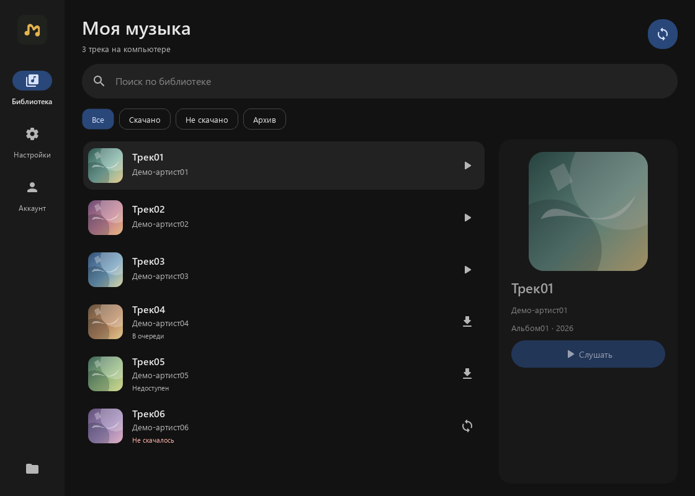
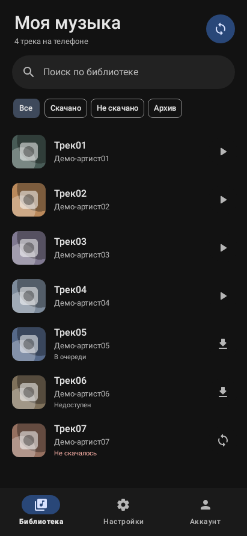
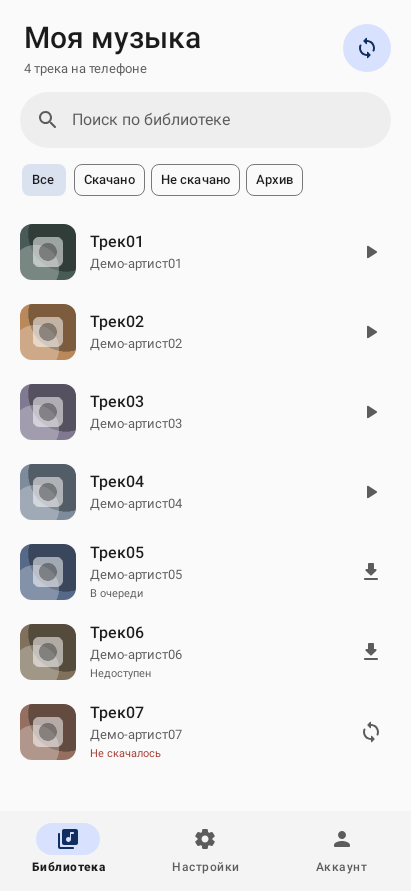

# Ya Music Downloader

«Моя музыка» для Windows и Android. Сохраняет избранное из Яндекс Музыки
в обычные MP3 и дополняет локальную библиотеку, когда появляются новые песни.

> **Яндекс Музыка / Yandex Music downloader для Windows и Android.**
> Скачивание избранного в MP3, синхронизация библиотеки и офлайн-прослушивание.

<sub>Неофициальный проект. Не связан с Яндексом и сервисом «Яндекс Музыка».</sub>

Зачем, когда много аналогов? — Просто так, делал в первую очередь для своих нужд.

Проект буду поддерживать по мере поступления проблем, так что в случае чего —
оставляйте issue, постараемся разобраться :)

## Скачать

[Релизы Windows и Android](https://github.com/Holorigg/ya-music-downloader/releases/latest).
У обеих платформ общий номер версии.

- **Android:** установи APK. Обновление устанавливается поверх прежней версии.
- **Windows:** распакуй portable ZIP и запусти `MyMusic.exe` либо скачай
  отдельный EXE. Python, Qt и FFmpeg включены. Windows 10 22H2 / 11, x64.



<p align="center">
  
  
</p>

Все треки, исполнители и обложки на скриншотах выдуманы.
[Светлая тема Windows](docs/screenshots/desktop-light.png).

## Возможности

- Синхронизация избранного без повторной загрузки сохранённых песен.
- Восстановление библиотеки из существующих экспортов после переустановки
  или запуска с пустой базой: проверяются имя с ID, теги и полный MP3.
- Выбор папки, проверка файлов, продолжение после остановки и повтор ошибок.
- ID3-теги и обложки.
- **Тексты песен — WIP:** Яндекс отдаёт их нестабильно, они могут вообще не
  подтянуться. Если текст удалось получить, он сохраняется в MP3 и `.txt`,
  синхронный — также в `.lrc`.
- Поиск по библиотеке и плейлист `.m3u8`.
- Архив снятых лайков: записи можно скрыть или очистить, файлы сохраняются.
- Тёмная, светлая и системная темы. Необязательная автосинхронизация.
- Вход через официальный сайт Яндекса и повторный вход из приложения.

| | Windows | Android |
|---|---|---|
| Интерфейс | Python / PySide6 | Java / Material 3 |
| Воспроизведение | Назначенный плеер Windows | Встроенный плеер |
| Автосинхронизация | Пока приложение открыто, включая свёрнутое окно | Фоновая задача Android |
| Системные цвета | Акцент Windows | Material You на поддерживаемых устройствах |

Автоматический режим изначально выключен. На Android время фонового запуска
зависит от ограничений системы; есть настройка «Только Wi-Fi».

## Запуск из исходников

### Windows

Нужны Python 3.12 x64 и FFmpeg с FFprobe в `PATH`.

```powershell
cd desktop
.\setup.ps1
.\Start-Music.cmd
```

[Установка, CLI и расположение данных](desktop/README.md).

### Android

**Android 8.0 и новее.** Один универсальный APK для ARM64, 32-битного ARM,
x86 и x86_64. Привязки к производителю процессора нет: Snapdragon, MediaTek,
Exynos, Kirin, Tensor и Unisoc подходят при совместимой версии Android.

Приложение написано на Java и не содержит нативных библиотек `.so`;
отдельный APK под каждый чип не требуется. Это следует из состава сборки
и [правил совместимости Android](https://developer.android.com/google/play/requirements/64-bit).
Основные сценарии проверены на Honor 200; другие устройства пока не тестировались.

Google Play Services не нужны. Для загрузки нужен интернет, для воспроизведения
сохранённых песен — нет. Папка выбирается через системное окно; рекомендуется
`Music/Моя музыка`. Динамические цвета доступны на Android 12+ при поддержке
прошивки. Фоновую синхронизацию можно включить отдельно.

Для сборки нужны JDK 17, Android SDK Platform 35 и Build Tools 35.0.0.

```powershell
cd android
.\gradlew.bat :app:assembleDebug
```

[Совместимость, сборка APK и подпись](android/README.md).
Debug-версия устанавливается отдельно от обычной «Моей музыки».

После запуска войди на вкладке «Аккаунт», выбери папку и нажми синхронизацию.
[Подробное руководство](docs/usage.md) · [Разработка и проверки](docs/contributing.md).

Сохраняются полные MP3, которые сервис предоставляет вошедшему аккаунту;
для подписочного контента нужен активный Плюс. Доступность конкретного трека,
обложки и текста зависит от сервиса.

## Лицензия и благодарности

Собственный код — [MIT](LICENSE). Зависимости и сторонние материалы сохраняют
свои лицензии: [полный перечень](docs/third-party-notices.md).

Спасибо [MarshalX / yandex-music-api](https://github.com/MarshalX/yandex-music-api)
за описание форматов и параметров API, [Qt for Python](https://doc.qt.io/qtforpython-6/),
[Material Components](https://github.com/material-components/material-components-android),
[Mutagen](https://github.com/quodlibet/mutagen) и [FFmpeg](https://ffmpeg.org/)
за компоненты приложения. Клиент HTTPS написан в этом проекте;
Python-библиотека `yandex-music-api` не импортируется.

Иконка приложения создана с GPT Image. Близкий проект сообщества:
[llistochek/yandex-music-downloader](https://github.com/llistochek/yandex-music-downloader).
